<div align="center">

# MINISTRY HUB

### Church Management Made Simple.

A modern, full-stack church management system designed specifically for Seventh-day Adventist (SDA) churches.

**Faith. Stewardship. Service.**


**[Visit Live Application](https://ministry-hub.netlify.app/)**

[Overview](#overview) • [Screenshots](#screenshots) • [Features](#features) • [Architecture](#system-architecture) • [Installation](#installation) • [Project Status](#project-status)

</div>

---

## Overview

Ministry Hub is a comprehensive digital church management system designed to streamline administrative and operational activities within Seventh-day Adventist (SDA) churches.

The platform provides pastors, elders, church clerks, treasurers and administrators with a centralised digital workspace for managing membership records, visitors, attendance, church events, tithes and offerings, announcements and administrative reports.

Developed around the organisational and administrative needs of Seventh-day Adventist churches, Ministry Hub promotes efficient administration, responsible financial stewardship and effective communication.

By reducing manual administrative responsibilities, the platform enables church leaders to dedicate more time to spiritual growth, evangelism, fellowship and community service.

---

## Problem Statement

Church administration often involves manual record-keeping, physical registers, spreadsheets and fragmented communication channels.

These approaches can create challenges such as:

- Inconsistent membership records
- Time-consuming administrative processes
- Difficulty monitoring church attendance
- Fragmented financial records
- Inefficient communication
- Difficulty generating administrative reports
- Potential loss of important church records
- Limited access to centralised information

Ministry Hub addresses these challenges by providing an integrated digital platform for church administration.

---

## Project Objectives

- Digitise Seventh-day Adventist church administration.
- Centralise church membership records.
- Improve financial accountability and stewardship.
- Simplify Sabbath service attendance tracking.
- Support visitor engagement and follow-up.
- Improve communication between church leaders and members.
- Simplify church event and programme management.
- Support informed administrative decision-making.
- Reduce reliance on manual record-keeping.
- Provide a foundation for future church digital transformation.

---

## Screenshots

### Landing Page

A welcoming public-facing website introducing Ministry Hub and its purpose.


### Platform Features

An overview of the platform's core church management capabilities.


### About Ministry Hub

A platform built with ministry work, church administration and stewardship in mind.


### Authentication

A dedicated authentication interface for authorised church personnel.

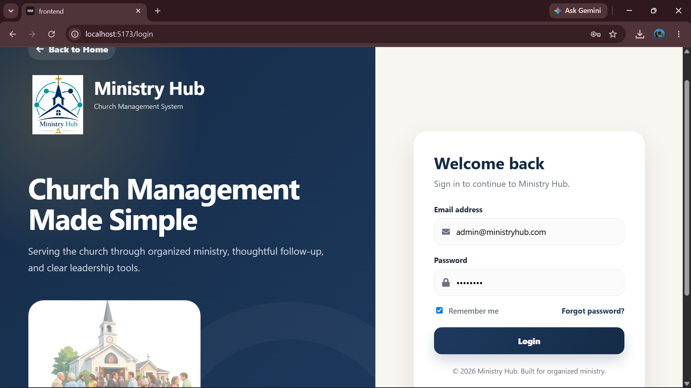

### Administrative Dashboard

A centralised overview of church operations, membership statistics, attendance and financial information.

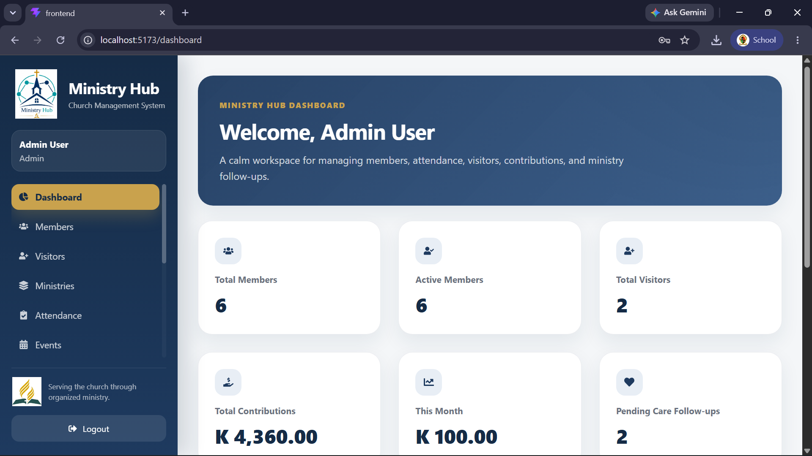

### Membership Management

Manage church membership records and access individual member information.

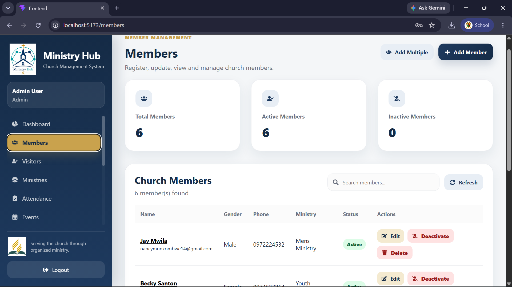

### Member Profile

View individual church member records through a dedicated profile interface.


### Visitor Management

Register church visitors and support visitor engagement and follow-up.

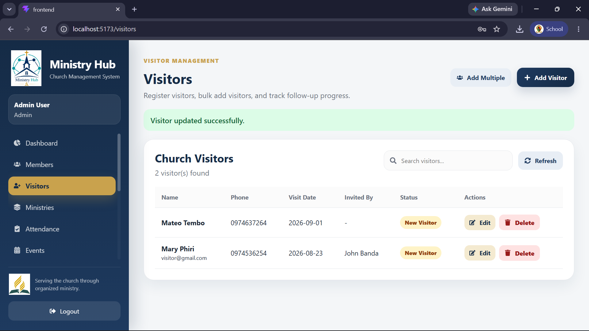

### Attendance Management

Manage attendance sessions and monitor participation in church services and meetings.

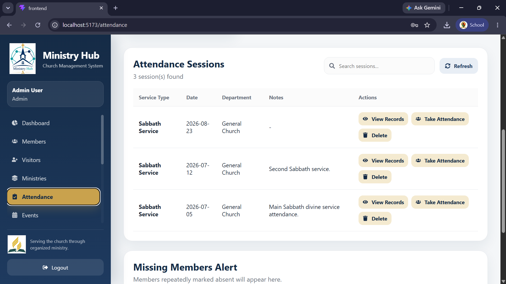

### Church Events

Organise church programmes, events and ministry activities.

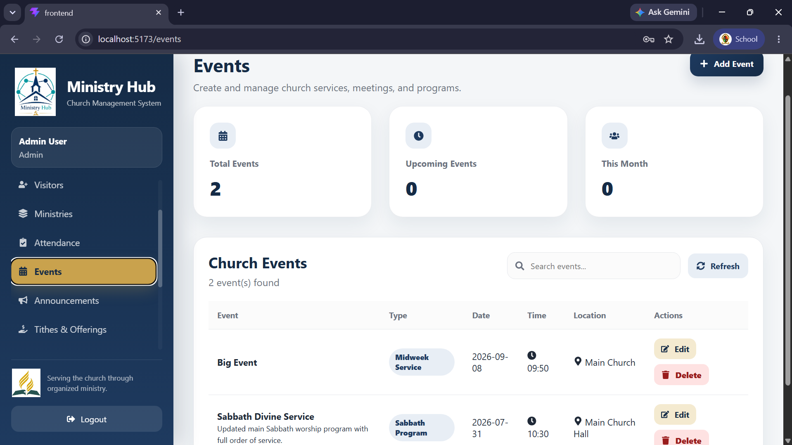

### Tithes and Offerings

Record church financial contributions and support responsible financial stewardship.


### Church Announcements

Create and manage important church announcements and communications.

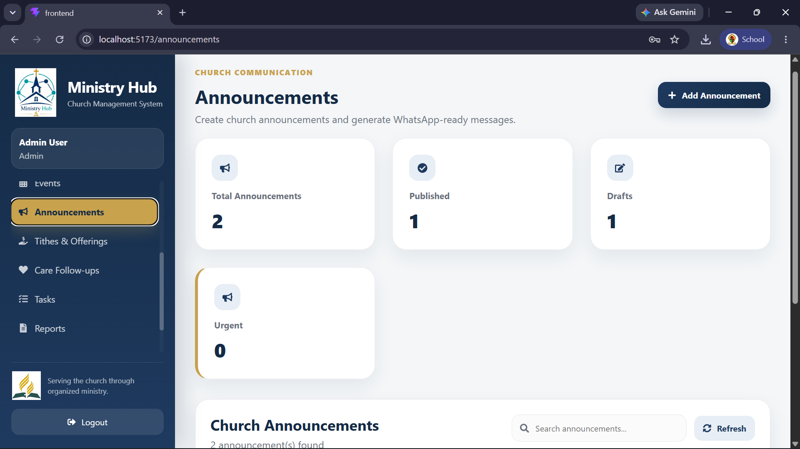

### WhatsApp Communication

A WhatsApp message interface designed to support church communication workflows.


### Reports and Analytics

Access administrative reports, financial summaries and operational information.

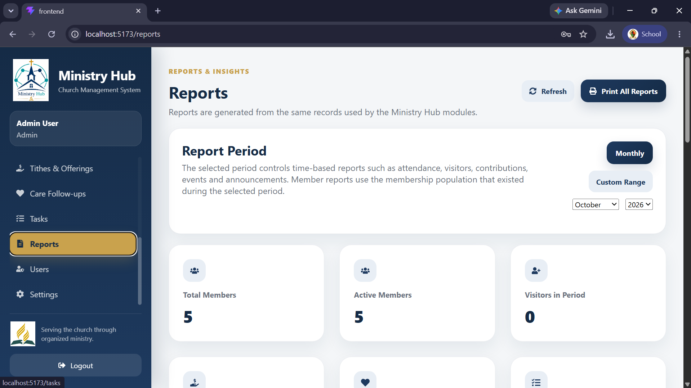

### User Management

Manage system user accounts and administrative access.


### Church Information

Maintain essential church information and organisational details.


### Church Leadership and Settings

Manage church leadership information and application settings.

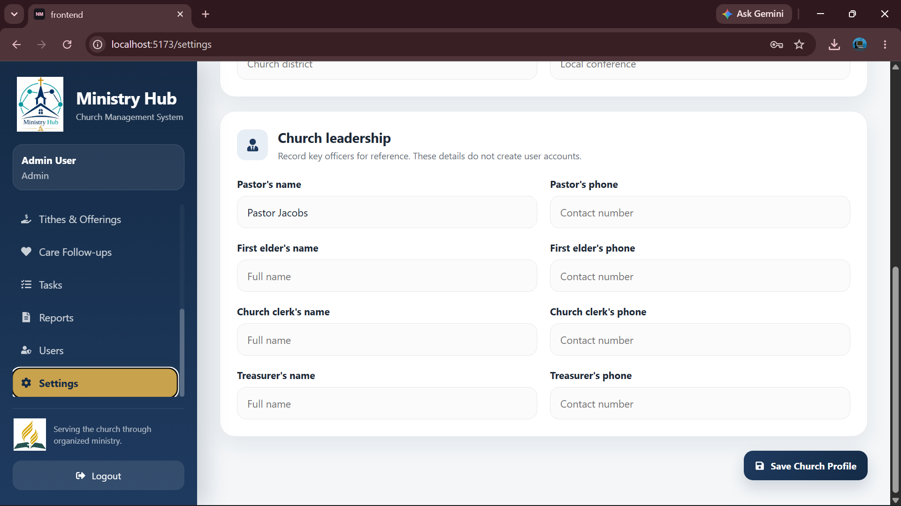

### Confirmation Dialogs

Interactive confirmation prompts help prevent accidental deletion of important church records.


---

## Features

### Administrative Dashboard

- Centralised church administration
- Membership statistics
- Visitor statistics
- Attendance summaries
- Financial summaries
- Operational performance indicators
- Quick access to management modules

### Membership Management

- Church member registration
- Individual member profiles
- Membership record management
- Personal and contact information
- Membership statistics
- Centralised membership database

### Visitor Management

- Visitor registration
- Visitor record management
- Contact information
- Visitor statistics
- Support for evangelism and visitor follow-up

### Attendance Management

- Sabbath service attendance tracking
- Attendance session management
- Church meeting attendance
- Attendance records
- Historical attendance information
- Participation monitoring

### Church Events

- Event creation and management
- Church programme scheduling
- Upcoming event information
- Ministry activity coordination
- Event record management

### Financial Stewardship

- Tithe recording
- Offering recording
- Financial contribution management
- Financial summaries
- Financial record tracking
- Reporting in Zambian Kwacha (ZMW)
- Support for church treasury administration

### Communication

- Church announcements
- Announcement management
- WhatsApp message interface
- Church programme communication
- Centralised administrative communication

### Authentication and User Management

- User authentication
- JWT-based authentication
- Password hashing
- Administrative user management
- Protected application functionality
- Account management

### Church Administration

- Church information management
- Church leadership records
- Organisational information
- Application settings
- Administrative record management
- Interactive confirmation dialogs

### Reporting and Analytics

- Membership summaries
- Attendance reports
- Financial summaries
- Visitor information
- Administrative reports
- Support for informed decision-making

---

## Target Users

Ministry Hub is designed to support the administrative responsibilities of local Seventh-day Adventist churches.

| User | Intended Responsibilities |
|---|---|
| Pastor | Ministry oversight and church administration |
| Church Elder | Church leadership and administrative oversight |
| Church Clerk | Membership and administrative records |
| Church Treasurer | Tithes, offerings and financial records |
| Ministry Leader | Church programmes and ministry activities |
| Administrator | System administration and user management |

These responsibilities represent intended use cases and do not necessarily correspond to separate implemented permission roles.

---

## Technology Stack

### Frontend

| Technology | Purpose |
|---|---|
| React | Component-based user interface |
| Vite | Frontend development and build tool |
| JavaScript | Application functionality |
| HTML5 | Application structure |
| CSS3 | Styling and responsive layouts |
| React Router | Application navigation |
| Axios | API communication |

### Backend

| Technology | Purpose |
|---|---|
| Node.js | Server-side JavaScript runtime |
| Express.js | Backend application framework |
| REST API | Client-server communication |
| JSON Web Tokens | User authentication |
| bcrypt | Password hashing |

### Database and Development

| Technology | Purpose |
|---|---|
| PostgreSQL | Current relational database |
| Supabase | Managed cloud PostgreSQL database |
| Netlify | Live frontend hosting |
| Render | Live backend API hosting |
| MySQL | Original development database (legacy) |
| Git | Version control |
| GitHub | Source code management |
| Visual Studio Code | Development environment |

---

## Brand Identity

Ministry Hub combines a professional visual identity with a welcoming, ministry-focused user experience.

| Colour | Purpose |
|---|---|
| Navy Blue | Primary branding and navigation |
| Gold | Highlights and primary actions |
| White | Content surfaces |
| Light Grey | Dashboard backgrounds |
| Slate | Secondary text and interface elements |

The visual identity reflects trust, stewardship, organisation, professionalism and community.

**Brand Name:** Ministry Hub

**Tagline:** Church Management Made Simple.

**Core Values:** Faith. Stewardship. Service.

---

## System Architecture

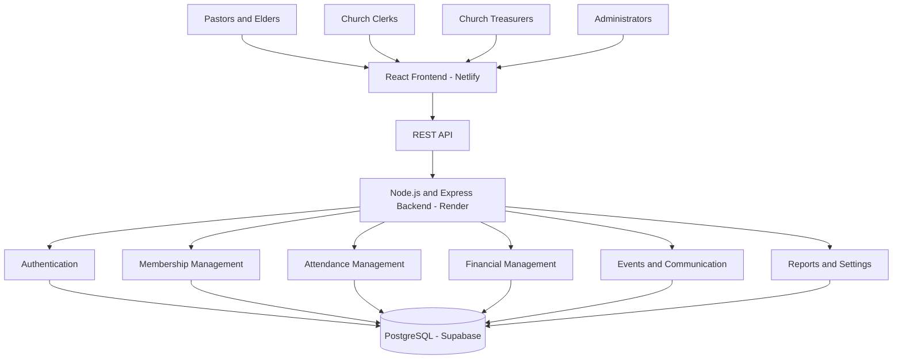

Ministry Hub follows a client-server architecture that separates presentation, application logic and persistent data storage.

This modular architecture provides a foundation for maintainability, scalability and future platform expansion.

---

## Application Modules

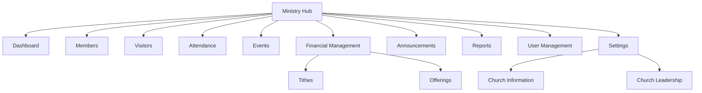

---

## Database Architecture

Ministry Hub uses a relational database to organise church records and maintain structured administrative information.

The database supports the following information categories:

| Category | Description |
|---|---|
| Users | System accounts and authentication |
| Members | Church membership information |
| Visitors | Church visitor records |
| Attendance | Attendance sessions and participation |
| Events | Church programmes and activities |
| Financial Records | Tithes and offerings |
| Announcements | Church communication records |
| Church Information | Organisational information |
| Settings | Administrative configurations |

The original MySQL database was migrated to PostgreSQL. The deployed application uses Supabase with 15 tables in the `ministry_private` schema. The Express backend connects directly to PostgreSQL using a pooled, TLS-verified connection. The browser communicates with the REST API rather than connecting directly to the database.

---

## Project Structure

The application is organised around separate frontend and backend components, together with project documentation and screenshots.

```text
ministry-hub/
│
├── frontend/          # React frontend
├── backend/           # Node.js and Express backend
├── database/          # PostgreSQL schema (schema.sql)
├── screenshots/       # Application screenshots
└── README.md          # Project documentation
```

---

## Installation

### Prerequisites

- Node.js and npm
- Git
- A separate Supabase project or PostgreSQL development database
- Visual Studio Code (optional)

### 1. Clone the repository

```bash
git clone https://github.com/nancymunkombwe/ministry-hub.git
cd ministry-hub
```

### 2. Configure the database

Create a separate Supabase project. In its SQL Editor, run `database/schema.sql` once to initialise the 15 tables. Use fictional records for demonstrations. Do not run the schema against an existing production database without reviewing it first.

From the Supabase **Connect** dialog, copy the Session pooler URI (port 5432). Replace the password placeholder with your database password, URL-encoding special characters as needed. Keep the URI private.

### 3. Configure and install the backend

```powershell
cd backend
Copy-Item .env.example .env
npm ci
```

Edit `backend/.env` using the following template. All credential values are placeholders.

```dotenv
PORT=5000
NODE_ENV=development
DATABASE_URL=YOUR_POSTGRESQL_CONNECTION_URI
DB_SSL=true
PG_CA_BASE64=YOUR_BASE64_ENCODED_CA_CERTIFICATE
JWT_SECRET=YOUR_UNIQUE_RANDOM_SECRET
FRONTEND_URL=http://localhost:5173
ADMIN_NAME=Ministry Hub Administrator
ADMIN_EMAIL=YOUR_ADMIN_EMAIL
ADMIN_PASSWORD=YOUR_UNIQUE_ADMIN_PASSWORD
```

Use the provider CA certificate for TLS verification. Generate a random JWT secret and choose a unique administrator password of at least 12 characters. Never commit real credentials.

### 4. Create the administrator and start the backend

```powershell
npm run create-admin
npm run dev
```

Remove `ADMIN_PASSWORD` from `.env` after creating the account. Check the backend health endpoint at http://localhost:5000/api/health.

### 5. Configure and start the frontend

Open another terminal from the project root.

```powershell
cd frontend
Copy-Item .env.example .env
npm ci
```

Set `frontend/.env`:

```dotenv
VITE_API_URL=http://localhost:5000/api
```

```powershell
npm run dev
```

Open http://localhost:5173 and sign in using the administrator account.

---

## Cloud Deployment

**Live application:** https://ministry-hub.netlify.app/

| Service | Purpose | Configuration |
|---|---|---|
| GitHub | Version control | `master` branch |
| Netlify | React frontend | Base: `frontend`; build: `npm run build`; publish: `dist` |
| Render | Express REST API | Root: `backend`; build: `npm ci`; start: `npm start` |
| Supabase | PostgreSQL database | Separate project; `ministry_private` schema |

Set `VITE_API_URL` on Netlify to the actual HTTPS Render backend URL followed by `/api`. Set `FRONTEND_URL` on Render to `https://ministry-hub.netlify.app` (without a trailing slash). Store the remaining backend secrets only in Render's environment settings.

The deployment uses free hosting tiers, subject to provider quotas, inactivity policies and availability. It is intended for demonstration and portfolio use pending a formal production readiness review.

---

## Security and Privacy

Ministry Hub handles potentially sensitive church membership, personal and financial information.

The deployed application incorporates JWT authentication, password hashing, server-side role restrictions for financial information, restricted CORS and TLS certificate verification for database connections. These measures are not a substitute for a formal security audit. Full permission, dependency, privacy and reliability testing remains outstanding before handling real church records.

Recommended security practices include:

- Secure password storage
- Protected environment variables
- Restricted administrative access
- Server-side input validation
- HTTPS in production
- Regular database backups
- Protection of membership records
- Protection of confidential financial information
- Responsible handling of personal data
- Administrative audit trails

Public demonstration screenshots and sample databases should contain fictional or anonymised information.

---

## Development Milestones

### Phase 1 — Core Development

- [x] Administrative dashboard
- [x] Membership management
- [x] Individual member profiles
- [x] Visitor management
- [x] Attendance management
- [x] Church event management
- [x] Tithes and offerings
- [x] Church announcements
- [x] Reports
- [x] User management
- [x] Church information
- [x] Church leadership settings
- [x] Authentication

### Phase 2 — User Experience and Branding

- [x] Public landing page
- [x] Custom Ministry Hub branding
- [x] Modern administrative dashboard
- [x] Interactive confirmation dialogs
- [x] Dedicated login interface
- [x] WhatsApp message interface
- [x] Project documentation

### Phase 3 — Cloud Migration and Deployment

- [x] PostgreSQL database migration
- [x] Supabase database configuration
- [x] Secure database connection
- [x] Administrator account creation
- [x] GitHub integration
- [x] Backend deployment on Render
- [x] Frontend deployment on Netlify

### Post-development maintenance

- [ ] Formal security and access-control audit
- [ ] Dependency vulnerability review
- [ ] Database backup and recovery testing
- [ ] Ongoing bug fixes and maintenance as needed

The current feature scope is complete. Additional ministry modules and integrations are not committed development milestones.

---

## Expected Impact

Ministry Hub aims to contribute to the digital transformation of church administration through:

- Improved administrative efficiency
- Reduced manual paperwork
- Improved financial accountability
- Better membership engagement
- More organised church programmes
- Improved communication
- Centralised church information
- Support for responsible stewardship
- Increased availability of administrative information
- More time for ministry and community service

---

## Project Vision

Ministry Hub aims to support the digital transformation of Seventh-day Adventist churches in Zambia and beyond.

The long-term vision is to establish an integrated church management ecosystem connecting local churches, districts and conferences through accessible digital tools.

The platform seeks to strengthen administrative efficiency, financial stewardship, membership engagement and communication while supporting the mission and ministry of the Seventh-day Adventist Church.

By combining technology with ministry-focused administration, Ministry Hub aims to empower church leaders to focus more on people, spiritual development, evangelism and community service.

---

## Academic and Technical Application

Ministry Hub demonstrates the practical application of information systems and software engineering principles within a church administration environment.

The project incorporates concepts from:

- Full-stack web development
- Software engineering
- Relational database design
- REST API development
- Authentication and authorisation
- User interface and experience design
- Information systems management
- Business process digitisation
- Financial information management
- Digital transformation

---

## Project Status

**Development status: Completed (V2.0).**

**Deployment status: Live.**

The current church management system has been developed and deployed as a portfolio demonstration. No further feature development is scheduled. Maintenance, security verification and reliability reviews remain separate from the completed feature scope.

[Launch Ministry Hub](https://ministry-hub.netlify.app/)

---

## Developer

**Nancy Munkombwe**

University of Zambia

[GitHub Profile](https://github.com/nancymunkombwe)

---

## Disclaimer

Ministry Hub is an independently developed church management system designed to support Seventh-day Adventist churches.

It is not presented as an official application of, or as being officially endorsed by, the Seventh-day Adventist Church.

---

<div align="center">

# MINISTRY HUB

### Church Management Made Simple.

**Faith. Stewardship. Service.**

Built with purpose. Designed for ministry.

Designed and developed in Zambia.

Copyright © 2026 Ministry Hub. All rights reserved.

</div>
